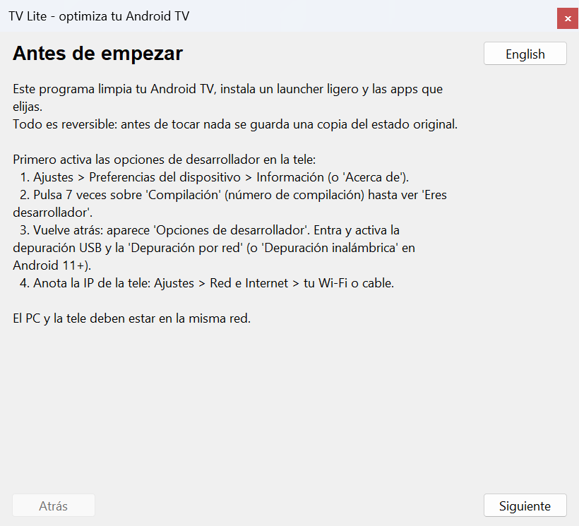
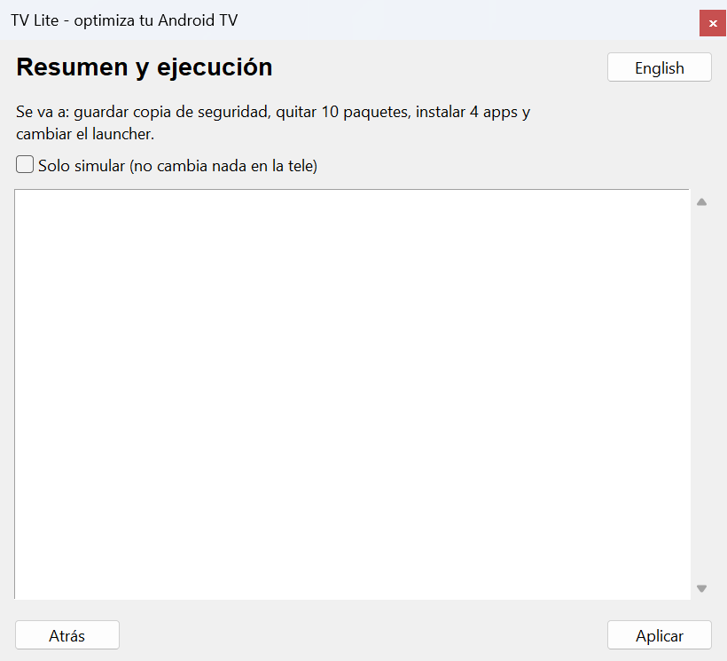

# android-tv-lite-launcher

[English](README.md) · **Español**

Optimiza una Android TV con poca RAM, **de forma reversible**: limpia el software que sobra, instala un launcher ligero y las apps que elijas, todo por ADB desde el PC. Pensado para que el usuario haga lo mínimo.

> **Estado: alfa.** Las listas de paquetes y el launcher se probaron en **una** tele real (TCL, Android 11, 940 MB de RAM). El instalador (`tvlite`) está probado con una tele simulada y con emuladores de Android TV, y en esa misma tele solo en parte: comandos de lectura, una simulación y una eliminación y restauración reales de una app de usuario. **Una limpieza completa desde un estado de fábrica, el cambio de launcher y las instalaciones desde Play Store aún no se han probado con `tvlite` en hardware real.** Ver [qué está probado](#qué-está-probado).


*Resultado final: la Home de una tele de 940 MB de RAM con Lite Launcher y 9 apps (Play Store siempre la primera). Captura de una tele real.*

## Qué hace

1. **Detecta tu tele** (marca, modelo, Android, procesador, RAM) y elige un perfil: `ultra_low` (≤ 1,2 GB), `low` (≤ 2,2 GB) o `normal`.
2. **Guarda un backup** de cómo está la tele antes de tocar nada: listas de paquetes, launcher, ajustes y el **APK de cada app de usuario que quite**.
3. **Limpia (debloat)** solo paquetes de listas revisadas, por niveles según la RAM. Play Store, Google Play Services y el sistema están protegidos.
4. **Instala las apps que elijas**: streaming populares, Stremio y VPN. Totalmente automático: sin pulsar nada más en la tele.
5. **Cambia el launcher** por [Lite Launcher](launcher/) (pequeño, nativo, sin animaciones), comprobando antes que arranca. El launcher original **no se desinstala**: se desactiva solo si hace falta.
6. **Restaura** todo desde el backup si algo no te gusta o falla.
7. **Mantiene la tele despierta y reconecta** sola si el Wi-Fi se cae o la tele se duerme a mitad del proceso.
8. **Mide antes y después** (RAM disponible, número de paquetes) para que veas qué ha cambiado.
9. **Verifica las descargas** (las herramientas de ADB contra el checksum que publica Google, Stremio contra un SHA-256 fijado).

## Uso

Necesitas Python 3.9+ (con Tkinter) en el PC. Todavía no hay ejecutable publicado: ver [Desarrollo](#desarrollo).

```bash
pip install ./installer
tvlite gui                       # asistente gráfico (o doble clic en el ejecutable, cuando exista)
tvlite plan 192.168.1.50         # ver qué se quitaría, sin tocar nada
tvlite apply 192.168.1.50 --dry-run
tvlite apply 192.168.1.50 --apps stremio,nordvpn
tvlite metrics 192.168.1.50      # RAM disponible y paquetes ahora mismo
tvlite report 192.168.1.50       # informe anónimo para pegar en un issue (no se envía nada)
tvlite backups                   # copias de seguridad guardadas
tvlite restore 192.168.1.50 <carpeta-del-backup>
```

**Antes de empezar, activa las opciones de desarrollador en la tele** (el asistente lo explica paso a paso): *Ajustes → Preferencias del dispositivo → Acerca de → pulsa 7 veces en "Compilación"*, y luego activa la depuración USB y la **depuración por red** (en Android 11+ puede llamarse *Depuración inalámbrica* y pedir un código de emparejamiento). El PC y la tele deben estar en la misma red; anota la IP de la tele.

ADB (`platform-tools` de Google) se descarga solo, por HTTPS, la primera vez, y se verifica contra el checksum que publica Google.

> **Al terminar, desactiva de nuevo la depuración por red** en la tele. Mientras esté activa, cualquier dispositivo de tu red puede conectarse a ella. El asistente y la línea de comandos te lo recuerdan al final.

## Paso a paso

Capturas del asistente (`tvlite gui`) recorriéndolo contra una **tele simulada** (`FakeAdb`, la misma que usan las pruebas); en una tele real los datos serán los de tu tele. Se regeneran con `python tools/docs/capture_gui.py docs/img es`.

**1. Antes de empezar.** Explica cómo activar las opciones de desarrollador y la depuración por red en la tele.



**2. Conectar.** Escribe la IP de la tele. Si tu tele usa *Depuración inalámbrica* con código de emparejamiento, rellena también esos campos. Si hace falta, la tele te pedirá aceptar la clave de este PC. ADB se descarga solo.


**3. Tu tele.** Marca, modelo, Android, procesador, RAM y almacenamiento, y el perfil de optimización según la RAM. Un botón copia un informe anónimo para pegarlo en un issue de GitHub.


**4. Limpieza.** Solo paquetes de listas revisadas, preseleccionados según la RAM. Los que pueden quitar una función llevan un aviso `(!)`; las apps de usuario llevan una etiqueta porque se guarda su APK antes de quitarlas, para poder restaurarlas.


**5. Apps a instalar.** Streaming, reproductores, Stremio y VPN. La mayoría se instalan desde **Play Store** (la tele debe tener la sesión de Google iniciada); Stremio se descarga de su web oficial.


**6. Resumen.** Dice qué se va a hacer. Marca *Solo simular* para ver el plan sin cambiar nada.



**7. Resultado.** Guarda la copia de seguridad antes de tocar nada, aplica los cambios, muestra la línea de RAM antes/después, te recuerda desactivar la depuración por red y deja el botón **Restaurar la tele** para deshacerlo todo.


**8. Resultado final en la tele.** Ejemplo de cómo queda la Home al terminar, con **9 apps** instaladas (Play Store, YouTube, Stremio, NordVPN, Red Bull TV y las propias de la tele): banners a pantalla completa con esquinas redondeadas, reloj arriba a la derecha y Play Store siempre la primera. Es una captura de la tele real del proyecto (TCL, 940 MB de RAM, Android 11). Con una pulsación larga sobre cualquier app puedes moverla, ocultarla o ver su información.


## Modelo de seguridad

Esto modifica el software de tu tele. Un error en una tele desconocida puede dejarla sin arrancar, así que:

- **Solo listas revisadas.** Nunca se quita "lo que parezca bloat". Cada lista indica en qué dispositivos reales se verificó (`verified_on`); las que no lo indican se ignoran salvo que se pida (`--include-unverified`) y nunca se preseleccionan.
- **Paquetes protegidos** (Play Store, GMS, SystemUI, ajustes, proveedores, red, Bluetooth…): no se quitan aunque aparezcan en una lista. Hay una prueba que lo comprueba y un validador de listas.
- **Apps de sistema** se quitan con `pm uninstall -k --user 0` y se recuperan con `install-existing`. En **apps de usuario** (instaladas en `/data/app`) el APK se borra al quitarlas y `install-existing` deja un registro fantasma que *dice* estar instalado. Por eso, **antes de quitar una app de usuario se guarda su APK (base y splits) en el backup** y la restauración la reinstala desde ahí. Si no se puede guardar el APK, esa app **no se quita** (salvo que pases `--allow-irreversible`, y entonces queda anotado que no se podrá restaurar). La restauración siempre verifica que el paquete vuelve de verdad.
- **Por lotes y con comprobación de salud.** Si la tele deja de responder, se deshace el lote y se detiene el proceso.
- **Diario a disco.** Cada acción se escribe y sincroniza al momento: se puede restaurar aunque el programa se interrumpa o se pierda la conexión. Con la conexión perdida la herramienta se detiene, te dice dónde está el backup y deja disponible **Restaurar**.
- **Launcher con retroceso.** Se instala, se comprueba que abre, se asigna como inicio y se verifica que el botón Home lo abre; si no, se restaura el original y se retira el nuevo. Si ya hay un launcher con otra firma, se reinstala (solo se pierden sus propios ajustes).
- **Play Protect.** Algunas teles abren un diálogo al instalar un APK desconocido por ADB y la instalación se queda esperando. `tvlite` desactiva **solo** la verificación de instalaciones por ADB (`verifier_verify_adb_installs`) mientras instala sus propios APK, lo anota en el diario y lo restaura siempre. Es un cambio de seguridad acotado y temporal; si no te convence, instala el APK a mano.
- **Tele despierta.** `stay_on_while_plugged_in` se activa solo mientras dura el proceso, anotado en el diario y restaurado.
- **Modo simulación** (`--dry-run`): enseña qué haría sin cambiar nada.

## Qué está probado

Detalle completo y cómo añadir tu tele en [docs/DEVICES.es.md](docs/DEVICES.es.md).

| Entorno | Tipo | SoC / ABI | RAM | Android | Qué se probó |
|---|---|---|---|---|---|
| TCL Smart TV | **Hardware real** | MediaTek mt5867 (armeabi-v7a) | 940 MB | 11 | Listas de debloat, Lite Launcher y apps aplicados **a mano** (mismos comandos que automatiza `tvlite`). `tvlite` en sí se ejecutó aquí para `detect`, `plan`, `report`, `metrics`, `apply --dry-run` y una eliminación + restauración reales de una app de usuario con 4 APK (Red Bull TV). Aún no en hardware real: limpieza completa desde estado de fábrica, cambio de launcher, instalaciones desde Play Store. |
| AVD `atv9-1gb` | Emulado | x86 (aceleración WHPX) | 1 GB | 9 (API 28) | Suite de integración: detección, debloat, cambio de launcher (ruta sin roles), restauración, simulación de marca, `--dry-run`. |
| AVD `atv11-1gb` | Emulado | x86 | 1 GB | 11 (API 30) | La misma suite. |
| AVD `atv14-2gb` | Emulado | x86 | 2 GB | 14 (API 34) | La misma suite (con Play Store y Play Protect). |

**Procesadores probados en hardware real:** MediaTek mt5867.

El emulador no reproduce la GPU ni el SoC de una tele real: valida la lógica en distintas versiones de Android y RAM, **no** el rendimiento ni la compatibilidad de una marca. Las "marcas" del emulador son apps vacías con nombres de paquete (reales para TCL, sintéticos para `acme`) y la variable `TVLITE_SIMULATE`.

### Resultados medidos del launcher (una sola tele, muestras pequeñas)

| | Launcher de Google | Lite Launcher |
|---|---|---|
| RAM del proceso | 119–132 MB | 36–49 MB |
| Fotograma, mediana | 11 ms | 5 ms |

## Limitaciones conocidas

- **Instalar apps desde Play Store maneja su interfaz por ADB** (abre la ficha y pulsa Instalar): depende del diseño de Play Store y de que la tele tenga sesión de Google. Con `tvlite` todavía no se ha probado contra la Play Store de una tele real. Casi ninguna app tiene APK oficial descargable y no se redistribuyen APK de terceros. Stremio se descarga de su sitio oficial y se verifica.
- **Solo se han verificado los nombres de paquete de unas pocas apps** (marcadas `verified` en `apps.json`); el resto del catálogo está sin verificar.
- **Listas de debloat solo de TCL** (más las genéricas de Android/Google). Faltan marcas: [contribuye](CONTRIBUTING.es.md).
- **Interfaz gráfica**: probada con una prueba automática contra una tele simulada y revisada a ojo en capturas, no con personas usándola.
- Windows es la plataforma principal; Linux/macOS deberían funcionar pero no están probados.
- **Sin firma de lanzamiento aún**: hasta que el mantenedor cree una clave de lanzamiento (ver [docs/RELEASING.md](docs/RELEASING.md)) el APK del launcher se firma con una clave de depuración y el ejecutable de Windows no está firmado.
- Los comentarios del código y de las pruebas están sobre todo en español; la interfaz es bilingüe (es/en).

## Desarrollo

```bash
cd installer
pip install -e ".[dev]"
python -m pytest                 # pruebas unitarias con una tele simulada (sin hardware)
```

**Launcher** (necesita JDK 17+ y el SDK de Android con build-tools ≥ 35 y plataforma `android-30`):

```bash
ANDROID_SDK_ROOT=/ruta/al/sdk bash launcher/build.sh     # -> launcher/build/litelauncher.apk
```

**Emuladores de Android TV** (RAM y Android configurables; requieren aceleración de hardware):

```bash
python tools/emulator/emu.py list
python tools/emulator/emu.py setup atv11-1gb
python tools/emulator/emu.py start atv11-1gb
TVLITE_EMULATOR=1 TVLITE_EXPECT_RAM_MB=1024 python -m pytest installer/tests/integration -v
```

Estructura: `launcher/` (app Android), `installer/tvlite/` (núcleo, CLI y GUI), `installer/tests/` (unitarias + integración), `tools/emulator/` (emuladores y fixtures), `docs/`.

Lanzamientos (firma, checksums): [docs/RELEASING.md](docs/RELEASING.md).

## Licencia

[Apache-2.0](LICENSE).
