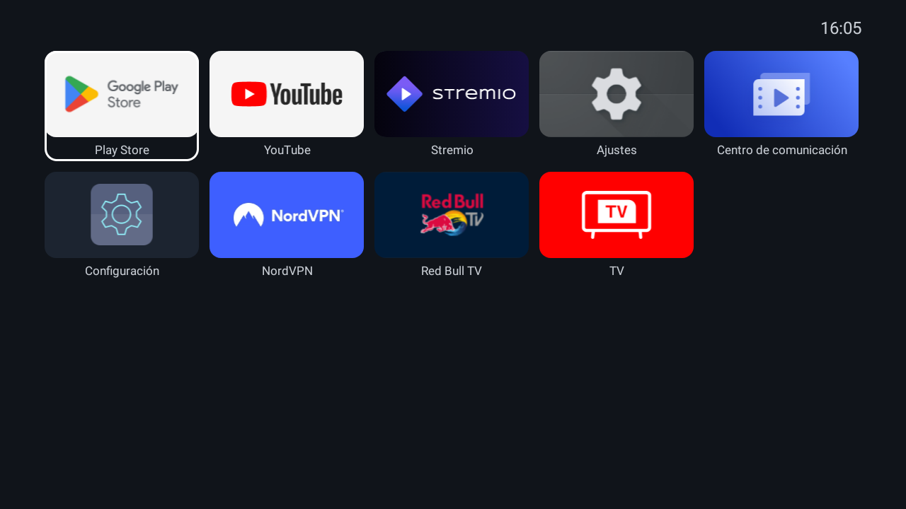
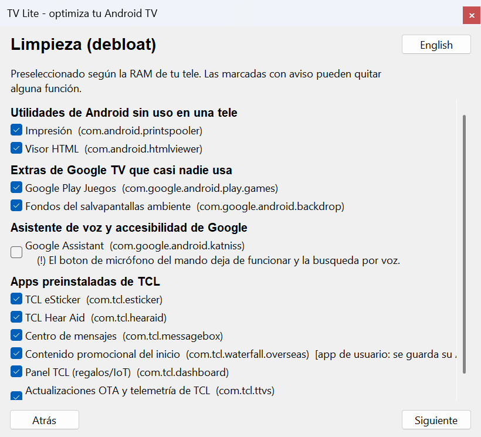
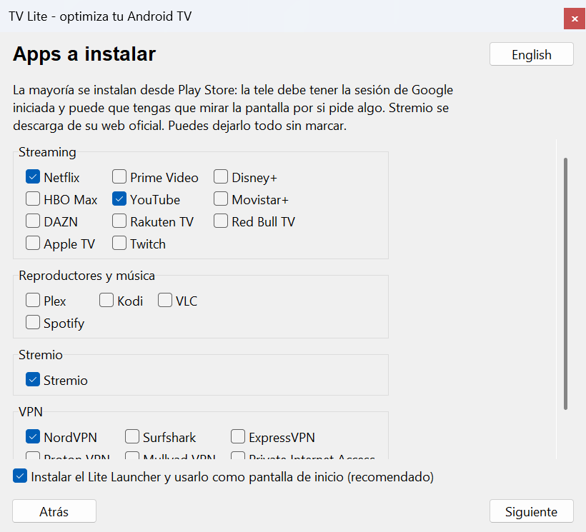
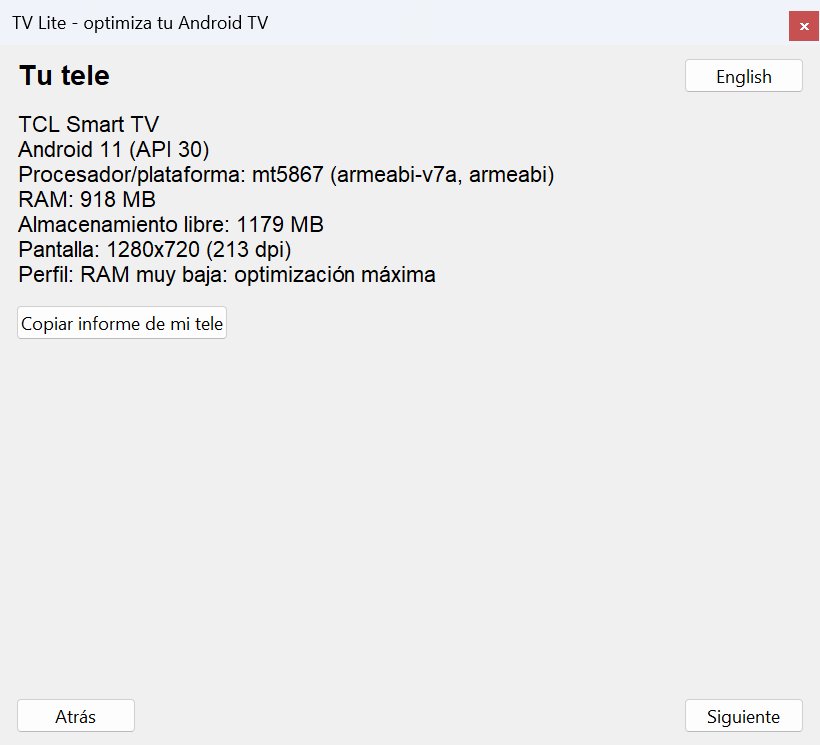
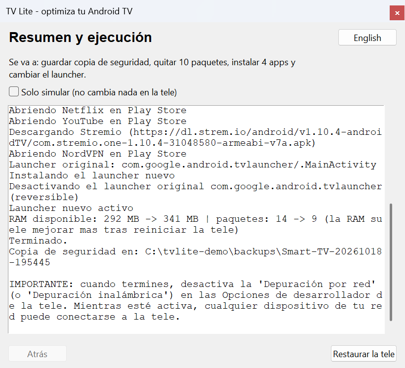

# android-tv-lite-launcher

[English](README.md) · **Español**

Optimiza una Android TV con poca RAM **de forma reversible**: limpieza segura, un launcher nativo diminuto y las apps que elijas, todo desde tu PC por ADB.

<!-- Botón de donaciones (DESACTIVADO hasta tener el enlace de PayPal): sustituye PAYPAL_URL y quita este comentario.

-->

> **Alfa.** Probado en **una tele real** (TCL, Android 11, 940 MB de RAM) y en emuladores. El instalador solo se ha usado en parte en esa tele. Ver [qué está probado](#qué-está-probado).

## Descarga: sin instalar nada

No necesitas Python ni nada más. Descarga tu archivo desde [Releases](../../releases) y haz doble clic (macOS/Linux: antes `chmod +x`):

| Sistema | Archivo |
|---|---|
| Windows 10/11 | `tvlite-windows-x64.exe` |
| macOS (Apple Silicon) | `tvlite-macos-arm64` |
| Linux (x86-64) | `tvlite-linux-x64` |

Detecta tu sistema y descarga, verifica y usa el ADB de Google él solo. Comprueba lo descargado con `SHA256SUMS`; los archivos no están firmados, así que Windows/macOS te pedirán confirmar una vez.

> **Aún no hay ningún release publicado** (hace falta la clave de firma del mantenedor, ver [RELEASING](docs/RELEASING.md)). Mientras tanto: [compilar desde el código](docs/DEVELOPMENT.es.md).

## Qué teles funcionan

Solo teles con **Android TV o Google TV** y Google Play Store (*Ajustes → Acerca de* lo dice). Sony, Philips, TCL, Xiaomi, TD Systems… **si** ese modelo lleva Android. **No soportadas:** LG (webOS), Samsung (Tizen), Roku TV, VIDAA (p. ej. Hisense 50A7100F), Fire TV. La marca por sí sola no decide.

## Qué hace

1. **Detecta tu tele** (modelo, Android, procesador, RAM, Play Store) y elige un perfil de optimización.
2. **Guarda un backup antes**: listas de paquetes, launcher, ajustes y el APK de cada app de usuario que quite.
3. **Limpia** solo paquetes de listas revisadas. Play Store y el sistema están protegidos.
4. **Instala las apps que elijas** (streaming, Stremio, VPN), de forma automática.
5. **Cambia a [Lite Launcher](launcher/)** (16 KB, nativo, sin animaciones) tras comprobar que abre. El launcher original solo se desactiva.
6. **Restaura todo** desde el backup con un clic, o solo si algo falla.

Paso a paso: 7 capturas del asistente

[Guía completa](docs/GUIDE.es.md) · [1 Bienvenida](docs/img/gui-es-1-welcome.png) · [2 Conectar](docs/img/gui-es-2-connect.png) · [3 Tu tele](docs/img/gui-es-3-your-tv.png) · [4 Limpieza](docs/img/gui-es-4-cleanup.png) · [5 Apps](docs/img/gui-es-5-apps.png) · [6 Resumen](docs/img/gui-es-6-summary.png) · [7 Resultado](docs/img/gui-es-7-result.png)

 
 

## Seguridad en un minuto

Solo listas revisadas (nunca "lo que parezca bloat"), paquetes protegidos, backup antes de cualquier cambio, lotes pequeños con comprobación de salud y retroceso automático. Todo es reversible; las apps de usuario se guardan antes como APK. Detalles y limitaciones conocidas: [docs/SAFETY.es.md](docs/SAFETY.es.md).

## Qué está probado

**Hardware real**

| Tele | Android | RAM | Procesador | Qué se probó |
|---|---|---|---|---|
| TCL Smart TV | 11 | 917 MB | MediaTek mt5867 | Listas, launcher y apps a mano. `tvlite`: comandos de lectura, simulación y una eliminación + restauración reales de una app de 4 APK. **Aún no:** una limpieza completa desde estado de fábrica, el cambio de launcher y las instalaciones de Play Store con `tvlite` |

**Modelos reales, simulados en un emulador** (identidad, RAM, versión de Android y nombres de paquete del modelo, en un emulador con RAM equivalente; 4 de 4 pruebas cada uno: detección, no se toca nada sin verificar, eliminación + restauración, informe):

| Modelo | Android | RAM | Procesador | Nombres de paquete de | Ficha de |
|---|---|---|---|---|---|
| TCL Smart TV | 11 | 917 MB | mt5867 | la tele real | la tele real |
| TD Systems M32C14GLE | 11 | 1 GB | desconocido | ninguno encontrado | ficha pública |
| TD Systems K32DLX15GLE | 9 | 1 GB | ARM Cortex quad-core | ninguno encontrado | ficha pública |
| TD Systems K32DLX10HS (AOSP, se supone sin Play Store) | 9 | 1,5 GB | ARM Cortex-A55 | ninguno encontrado | ficha pública |
| Xiaomi Mi TV 4A 32" | 9 (sin confirmar) | 1 GB | Amlogic T962 | listas de comunidad (sin verificar) | ficha pública |
| Philips 43PUS7406 | 10 | 2 GB **supuesto** | desconocido | solo `org.droidtv.zapster` | solo la versión de Android |
| Sony BRAVIA KD-43X80J | 10 | 2 GB **supuesto** | desconocido | listas de comunidad (sin verificar) | solo la versión de Android |

**No soportadas** (no son Android): Hisense 50A7100F (VIDAA U3), LG (webOS), Samsung (Tizen), Roku TV; Fire TV tampoco está soportada.

Un emulador no es una tele real: valida la lógica, no el hardware ni que quitar los paquetes de una marca sea seguro. "Supuesto" significa que el dato no se encontró y se usó un valor plausible. Fuentes y nivel de evidencia de cada campo: [docs/DEVICES.es.md](docs/DEVICES.es.md).

## Privacidad

`tvlite` **no envía nada** por sí solo. Al terminar puede ofrecerte un **informe anónimo del resultado** (modelo de la tele, Android, procesador, RAM, qué fue bien y el error, sin IP, usuario ni número de serie). Ves el contenido exacto antes y solo **Enviar** lo envía. [Detalles](docs/TELEMETRY.md).

## Contribuir

La ayuda más útil es **informar de tu tele**: `tvlite report <ip>` y pega el resultado en un issue. Faltan listas de paquetes de otras marcas. [CONTRIBUTING](CONTRIBUTING.es.md) · [Desarrollo](docs/DEVELOPMENT.es.md) · [Apache-2.0](LICENSE)
