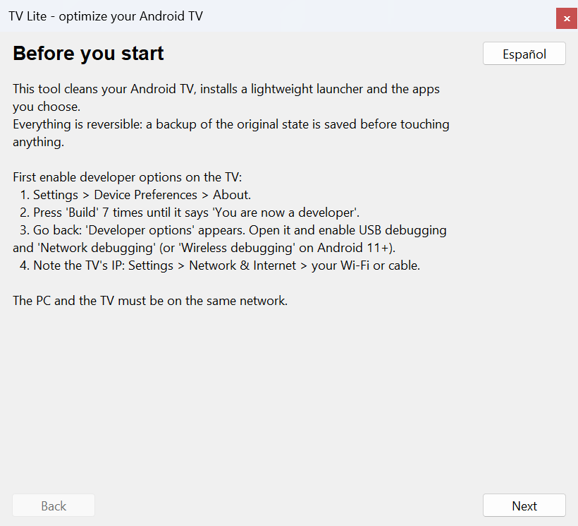
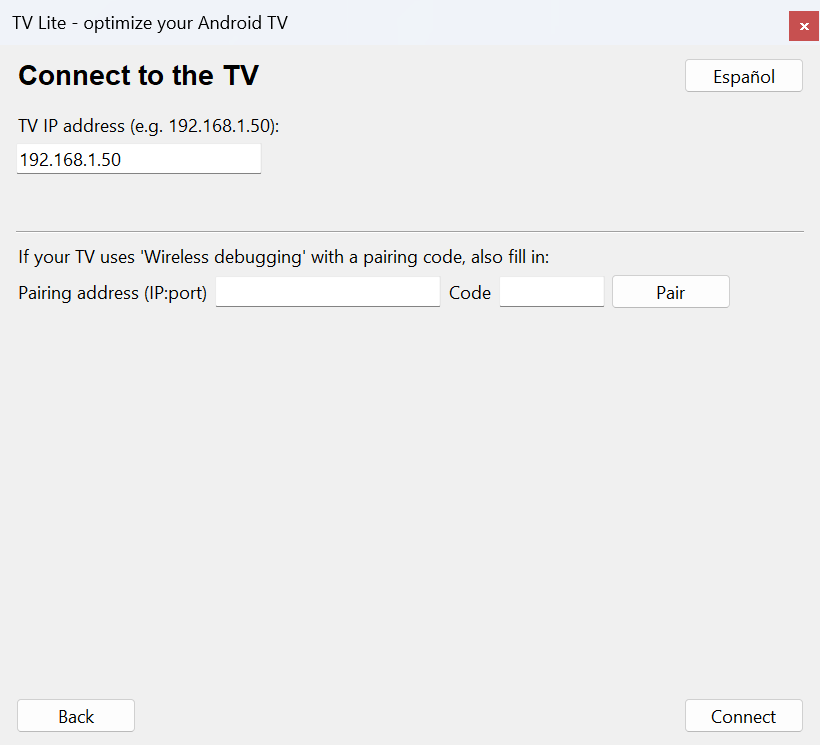
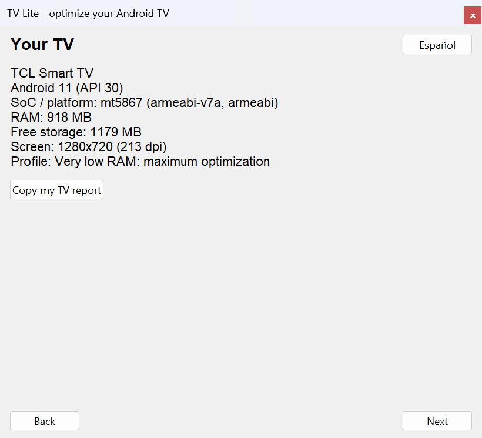
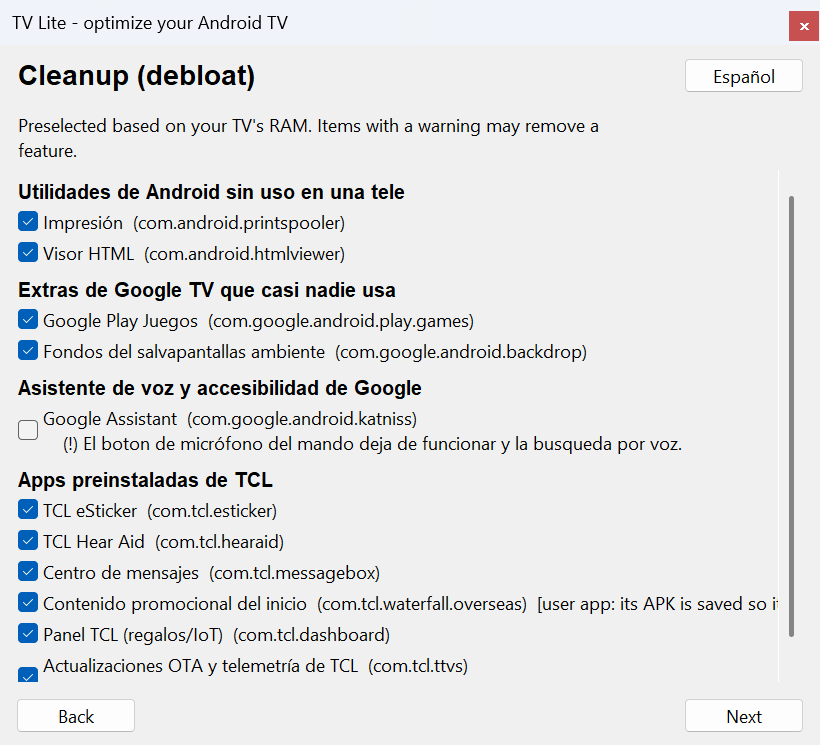
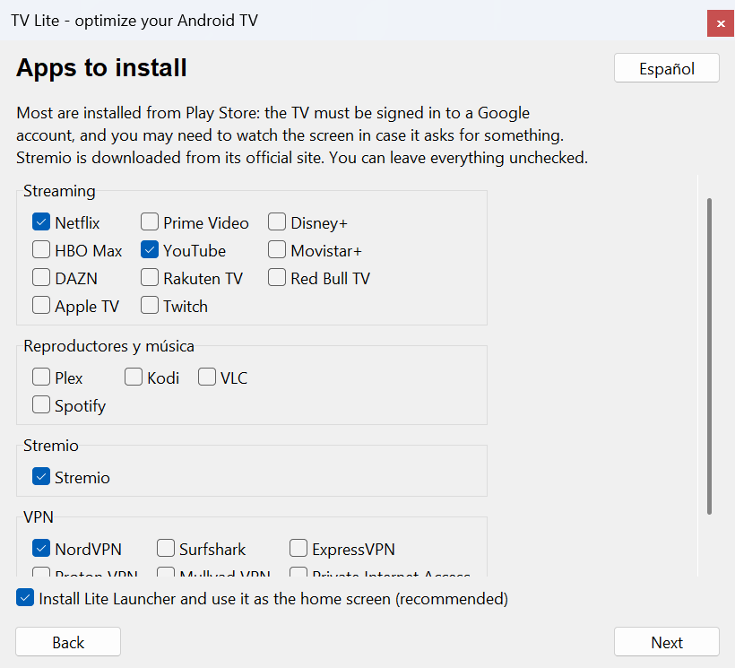
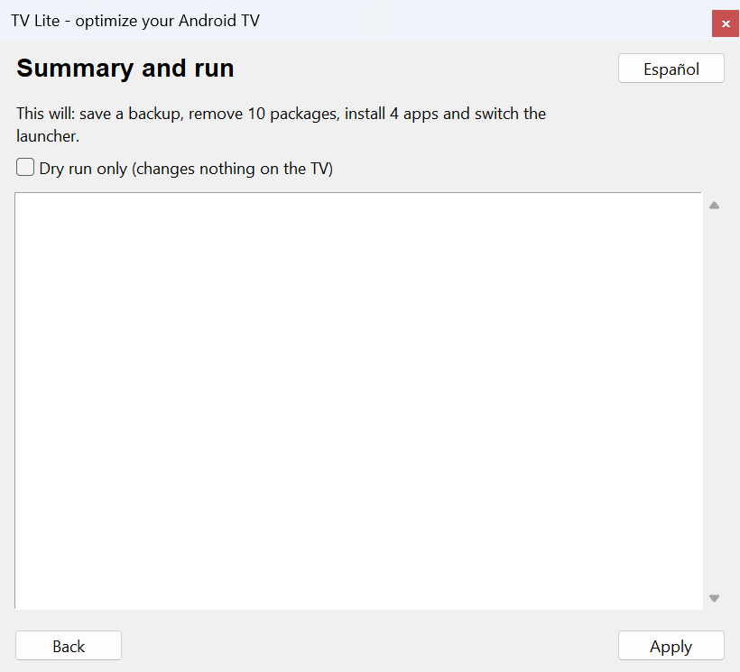
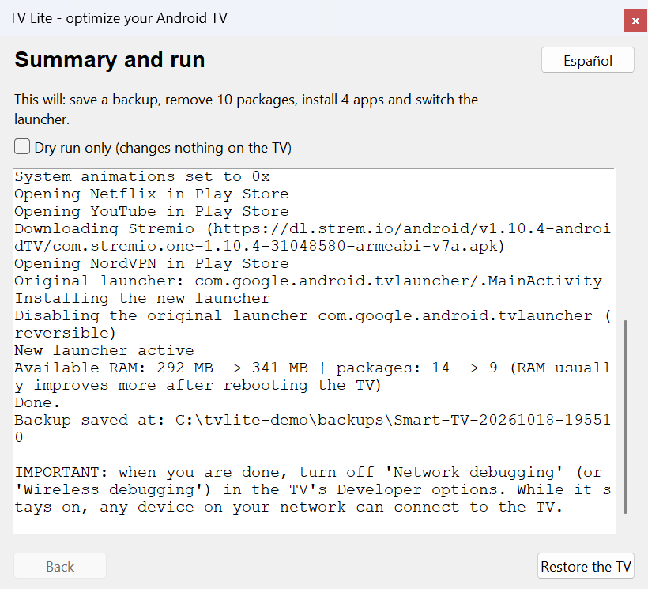

# android-tv-lite-launcher

**English** · [Español](README.es.md)

Optimize a low-RAM Android TV **reversibly**: remove the software you don't need, install a tiny launcher and the apps you choose, all over ADB from your PC. Designed so the user has to do as little as possible.

> **Status: alpha.** The package lists and the launcher were tested on **one** real TV (TCL, Android 11, 940 MB of RAM). The installer (`tvlite`) is tested against a simulated TV and Android TV emulators, and on that same TV only partially: read-only commands, a dry run and one real remove-and-restore of a user app. **A full cleanup from a stock state, the launcher switch and Play Store installs have not been exercised on real hardware with `tvlite` yet.** See [what is tested](#what-is-tested).


*End result: the home screen of a 940 MB TV with Lite Launcher and 9 apps (Play Store always first). Screenshot from a real TV.*

## What it does

1. **Detects your TV** (brand, model, Android, SoC, RAM) and picks a profile: `ultra_low` (≤ 1.2 GB), `low` (≤ 2.2 GB) or `normal`.
2. **Saves a backup** of the original state before touching anything: package lists, launcher, settings and the **APK of every user app it removes**.
3. **Debloats** only packages from reviewed lists, in tiers according to RAM. Play Store, Google Play Services and the core system are protected.
4. **Installs the apps you pick**: popular streaming apps, Stremio and VPNs. Fully automatic: no extra clicks on the TV.
5. **Switches the launcher** to [Lite Launcher](launcher/) (tiny, native, no animations), checking first that it opens. The original launcher is **never uninstalled**: it is only disabled if needed.
6. **Restores** everything from the backup if you don't like the result or something fails.
7. **Keeps the TV awake and reconnects** by itself if the Wi-Fi drops or the TV falls asleep mid-process.
8. **Measures before and after** (available RAM, package count) so you can see what changed.
9. **Verifies downloads** (ADB tools against Google's published checksum, Stremio against a pinned SHA-256).

## Usage

You need Python 3.9+ (with Tkinter) on the PC. There is no published executable yet: see [Development](#development).

```bash
pip install ./installer
tvlite gui                       # graphical wizard (or double-click the executable, once it exists)
tvlite plan 192.168.1.50         # see what would be removed, without touching anything
tvlite apply 192.168.1.50 --dry-run
tvlite apply 192.168.1.50 --apps stremio,nordvpn
tvlite metrics 192.168.1.50      # available RAM and packages right now
tvlite report 192.168.1.50       # anonymous report to paste in a GitHub issue (nothing is sent)
tvlite backups                   # saved backups
tvlite restore 192.168.1.50 <backup-folder>
```

**Before you start, enable developer options on the TV** (the wizard explains it step by step): *Settings → Device Preferences → About → press "Build" 7 times*, then enable USB debugging and **network debugging** (on Android 11+ it may be called *Wireless debugging* and ask for a pairing code). The PC and the TV must be on the same network; note the TV's IP.

ADB (Google's `platform-tools`) is downloaded automatically over HTTPS the first time, and verified against the checksum Google publishes.

> **When you are done, turn network debugging off again** on the TV. While it is on, any device on your network can connect to it. The wizard and the CLI remind you at the end.

## Step by step

Screenshots of the wizard (`tvlite gui`) walking through a **simulated TV** (`FakeAdb`, the same one the tests use); on a real TV the data will be your TV's. Regenerate them with `python tools/docs/capture_gui.py docs/img en`.

**1. Before you start.** Explains how to enable developer options and network debugging on the TV.



**2. Connect.** Type the TV's IP. If your TV uses *Wireless debugging* with a pairing code, fill in those fields too. The TV may ask you to accept this PC's key. ADB downloads itself.



**3. Your TV.** Brand, model, Android, SoC, RAM and storage, and the optimization profile that will be applied based on RAM. A button copies an anonymous report you can paste into a GitHub issue.



**4. Cleanup.** Only packages from reviewed lists, preselected according to RAM. Items that may remove a feature carry a `(!)` warning; user apps are tagged because their APK is saved before removal so they can be restored.



**5. Apps to install.** Streaming, players, Stremio and VPNs. Most are installed from **Play Store** (the TV must be signed in to a Google account); Stremio is downloaded from its official site.



**6. Summary.** Says what is about to happen. Tick *Dry run only* to see the plan without changing anything.



**7. Result.** Saves the backup before touching anything, applies the changes, shows the before/after RAM line, reminds you to turn network debugging off, and leaves a **Restore the TV** button to undo everything.



**8. Final result on the TV.** Example of how the home screen ends up, with **9 apps** installed (Play Store, YouTube, Stremio, NordVPN, Red Bull TV and the TV's own): full-bleed banners with rounded corners, clock at the top right and Play Store always first. This is a screenshot of the project's real TV (TCL, 940 MB of RAM, Android 11). A long press on any app lets you move it, hide it or see its info.


## Safety model

This modifies your TV's software. A mistake on an unfamiliar TV could leave it unable to boot, so:

- **Reviewed lists only.** It never removes "whatever looks like bloat". Each list states on which real devices it was verified (`verified_on`); lists without it are ignored unless you ask (`--include-unverified`) and are never preselected.
- **Protected packages** (Play Store, GMS, SystemUI, settings, providers, networking, Bluetooth…) are never removed, even if a list names them. A test checks it, and a list validator enforces it.
- **System apps** are removed with `pm uninstall -k --user 0` and brought back with `install-existing`. **User apps** (installed in `/data/app`) lose their APK when removed, and `install-existing` then leaves a "ghost" record that *claims* to be installed. So **before removing a user app its APK (base + splits) is saved in the backup** and restore reinstalls it from there. If the APK cannot be saved, that app is **not removed** (unless you pass `--allow-irreversible`, in which case it is logged as not restorable). Restore always verifies the package really came back.
- **Small batches with a health check.** If the TV stops responding, the batch is undone and the process stops.
- **On-disk journal.** Every action is written and synced immediately, so you can restore even if the program is interrupted or the connection drops. On a lost connection the tool stops, tells you where the backup is and leaves **Restore** available.
- **Launcher with rollback.** It installs, checks it opens, assigns it as home and verifies the Home button opens it; otherwise it restores the original and removes the new one. If a launcher with a different signature is already installed, it is reinstalled (only its own settings are lost).
- **Play Protect.** Some TVs show a dialog when an unknown APK is installed over ADB and the install hangs forever. `tvlite` turns off **only** the ADB-install verification (`verifier_verify_adb_installs`) while it installs its own APKs, writes it to the journal and always restores it. It is a narrow, temporary security change; if you are not comfortable with it, install the APK by hand.
- **Stay-awake window.** `stay_on_while_plugged_in` is set only while the process runs, journaled and restored.
- **Dry run** (`--dry-run`): shows what it would do without changing anything.

## What is tested

Full detail and how to add your TV in [docs/DEVICES.md](docs/DEVICES.md).

| Environment | Type | SoC / ABI | RAM | Android | What was tested |
|---|---|---|---|---|---|
| TCL Smart TV | **Real hardware** | MediaTek mt5867 (armeabi-v7a) | 940 MB | 11 | Debloat lists, Lite Launcher and apps applied **by hand** (the same commands `tvlite` automates). `tvlite` itself was run here for `detect`, `plan`, `report`, `metrics`, `apply --dry-run` and a real remove + restore of one user app with 4 APKs (Red Bull TV). Not yet on real hardware: full debloat from a stock state, launcher switch, Play Store installs. |
| AVD `atv9-1gb` | Emulated | x86 (WHPX acceleration) | 1 GB | 9 (API 28) | Integration suite: detection, debloat, launcher switch (no-roles path), restore, brand simulation, `--dry-run`. |
| AVD `atv11-1gb` | Emulated | x86 | 1 GB | 11 (API 30) | Same suite. |
| AVD `atv14-2gb` | Emulated | x86 | 2 GB | 14 (API 34) | Same suite (with Play Store and Play Protect). |

**SoCs tested on real hardware:** MediaTek mt5867.

The emulator does not reproduce a real TV's GPU or SoC: it validates the logic across Android versions and RAM sizes, **not** performance or a brand's compatibility. The emulator "brands" are empty apps with package names (real for TCL, synthetic for `acme`) plus the `TVLITE_SIMULATE` variable.

### Measured launcher results (one TV, small samples)

| | Google launcher | Lite Launcher |
|---|---|---|
| Process RAM | 119–132 MB | 36–49 MB |
| Frame time, median | 11 ms | 5 ms |

## Known limitations

- **Installing apps from Play Store drives its UI over ADB** (it opens the app page and presses Install), which depends on Play Store's layout and on the TV being signed in to Google. It has not been tried against a real TV's Play Store with `tvlite` yet. Almost no app ships an official downloadable APK, and third-party APKs are not redistributed. Stremio is downloaded from its official site and verified.
- **Only a few apps' package names are verified** (marked `verified` in `apps.json`); the rest of the catalog is unverified.
- **Debloat lists exist only for TCL** (plus generic Android/Google ones). Other brands are missing: [please contribute](CONTRIBUTING.md).
- **GUI**: tested by an automatic test against a simulated TV and checked by eye in screenshots, not with people using it.
- Windows is the main platform; Linux/macOS should work but are untested.
- **No release signing yet**: until the maintainer creates a release key (see [docs/RELEASING.md](docs/RELEASING.md)) the launcher APK is signed with a debug key and the Windows executable is not code-signed.
- The code and test comments are mostly in Spanish; the user-facing UI is bilingual (es/en).

## Development

```bash
cd installer
pip install -e ".[dev]"
python -m pytest                 # unit tests against a simulated TV (no hardware)
```

**Launcher** (needs JDK 17+ and the Android SDK with build-tools ≥ 35 and platform `android-30`):

```bash
ANDROID_SDK_ROOT=/path/to/sdk bash launcher/build.sh     # -> launcher/build/litelauncher.apk
```

**Android TV emulators** (configurable RAM and Android; need hardware acceleration):

```bash
python tools/emulator/emu.py list
python tools/emulator/emu.py setup atv11-1gb
python tools/emulator/emu.py start atv11-1gb
TVLITE_EMULATOR=1 TVLITE_EXPECT_RAM_MB=1024 python -m pytest installer/tests/integration -v
```

Layout: `launcher/` (Android app), `installer/tvlite/` (core, CLI and GUI), `installer/tests/` (unit + integration), `tools/emulator/` (emulators and fixtures), `docs/`.

Releases (signing, checksums): [docs/RELEASING.md](docs/RELEASING.md).

## License

[Apache-2.0](LICENSE).
