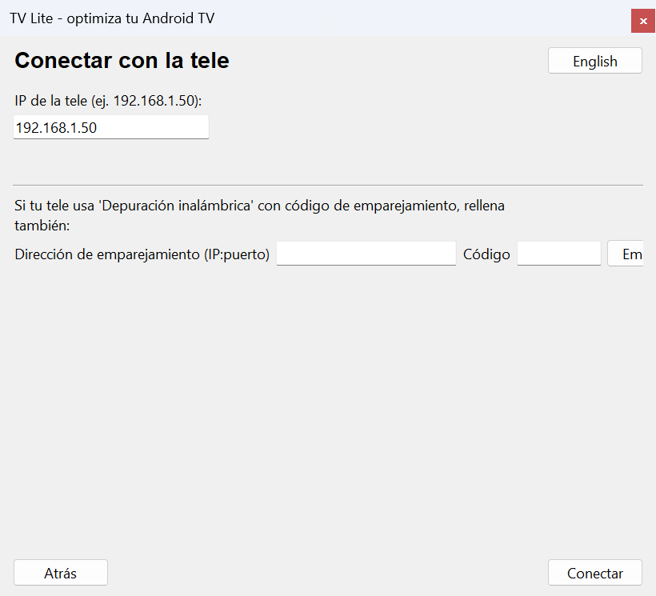
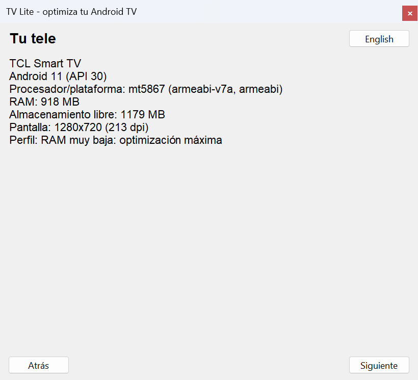
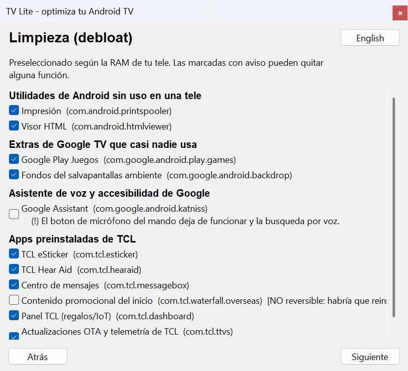
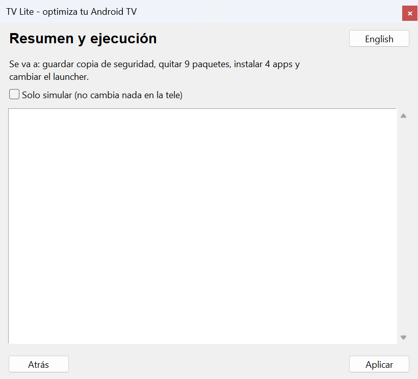
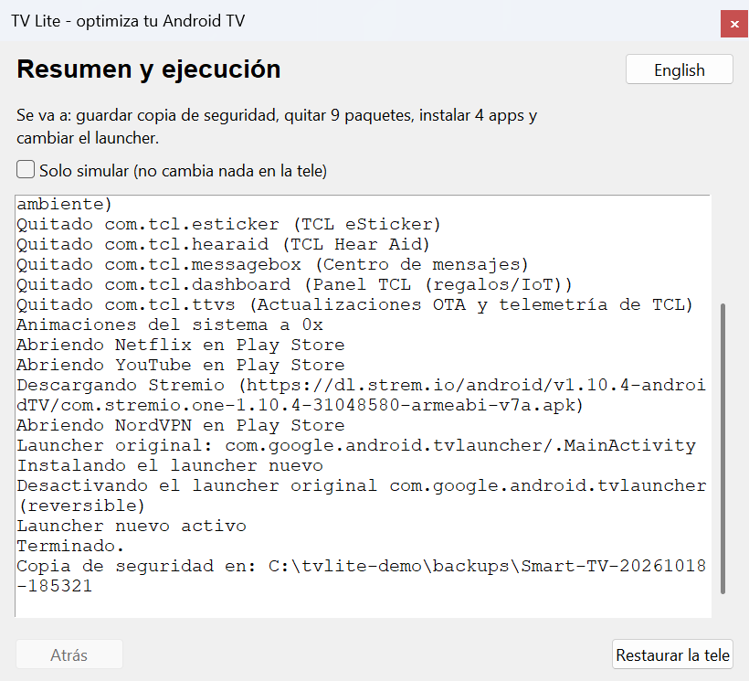

# android-tv-lite-launcher

Optimiza una Android TV con poca RAM, **de forma reversible**: limpia el software que sobra, instala un launcher ligero y las apps que elijas, todo por ADB desde el PC. Pensado para que el usuario haga lo mínimo.

> **Estado: alfa.** Las listas de paquetes y el launcher se probaron en **una** tele real (TCL, Android 11, 940 MB de RAM). El instalador (`tvlite`) está probado con una tele simulada y con emuladores de Android TV, **pero todavía no se ha ejecutado contra una tele física**. Ver [qué está probado](#qué-está-probado).


*Resultado final: la Home de una tele de 940 MB de RAM con Lite Launcher y 9 apps (Play Store siempre la primera). Captura de una tele real.*

*English: reversible optimizer for low-RAM Android TVs over ADB — safe debloat, a tiny native launcher and popular apps. Alpha; Spanish docs, contributions welcome.*

## Qué hace

1. **Detecta tu tele** (marca, modelo, Android, procesador, RAM) y elige un perfil: `ultra_low` (≤ 1,2 GB), `low` (≤ 2,2 GB) o `normal`.
2. **Guarda un backup** de cómo está la tele antes de tocar nada (paquetes, launcher, ajustes).
3. **Limpia (debloat)** solo paquetes de listas revisadas, por niveles según la RAM. Play Store, Google Play Services y el sistema están protegidos.
4. **Instala apps** que elijas: streaming populares, Stremio y VPN.
5. **Cambia el launcher** por [Lite Launcher](launcher/) (16 KB, nativo, sin animaciones), comprobando antes que arranca. El launcher original **no se desinstala**: se desactiva solo si hace falta.
6. **Restaura** todo desde el backup si algo no te gusta o falla.

## Uso

Necesitas Python 3.9+ (con Tkinter) en el PC. Todavía no hay ejecutable publicado: ver [Desarrollo](#desarrollo).

```bash
pip install ./installer
tvlite gui                       # asistente gráfico (o doble clic en el ejecutable, cuando exista)
tvlite plan 192.168.1.50         # ver qué se quitaría, sin tocar nada
tvlite apply 192.168.1.50 --dry-run
tvlite apply 192.168.1.50 --apps stremio,nordvpn
tvlite backups                   # copias de seguridad guardadas
tvlite restore 192.168.1.50 <carpeta-del-backup>
```

**Antes de empezar, activa las opciones de desarrollador en la tele** (el asistente lo explica paso a paso): *Ajustes → Preferencias del dispositivo → Acerca de → pulsa 7 veces en "Compilación"*, y luego activa la depuración USB y la **depuración por red** (en Android 11+ puede llamarse *Depuración inalámbrica* y pedir un código de emparejamiento). El PC y la tele deben estar en la misma red; anota la IP de la tele.

ADB (`platform-tools` de Google) se descarga solo, por HTTPS, la primera vez.

## Paso a paso

Capturas del asistente (`tvlite gui`) recorriéndolo contra una **tele simulada** (`FakeAdb`, la misma que usan las pruebas); en una tele real los datos serán los de tu tele. Se regeneran con `python tools/docs/capture_gui.py`.

**1. Antes de empezar.** El asistente explica cómo activar las opciones de desarrollador y la depuración por red en la tele.


**2. Conectar.** Escribe la IP de la tele. Si tu tele usa *Depuración inalámbrica* con código de emparejamiento, rellena también esos campos. Si hace falta, la tele te pedirá aceptar la clave de este PC. ADB se descarga solo.



**3. Tu tele.** Muestra marca, modelo, Android, procesador, RAM y almacenamiento, y el perfil de optimización que se aplicará según la RAM.



**4. Limpieza.** Lista solo paquetes de listas revisadas, preseleccionados según la RAM. Los que pueden quitar una función llevan un aviso `(!)`, y las apps de usuario, que **no se pueden restaurar**, salen sin marcar.



**5. Apps a instalar.** Streaming, reproductores, Stremio y VPN. La mayoría se instalan desde **Play Store** (la tele debe tener la sesión de Google iniciada); Stremio se descarga de su web oficial.


**6. Resumen.** Dice qué se va a hacer. Marca *Solo simular* para ver el plan sin cambiar nada.



**7. Resultado.** Guarda la copia de seguridad antes de tocar nada, aplica los cambios, y deja el botón **Restaurar la tele** para deshacerlo todo.



**8. Resultado final en la tele.** Ejemplo de cómo queda la Home al terminar, con **9 apps** instaladas (Play Store, YouTube, Stremio, NordVPN, Red Bull TV y las propias de la tele): banners a pantalla completa con esquinas redondeadas, reloj arriba a la derecha y Play Store siempre la primera. Es una captura de la tele real del proyecto (TCL, 940 MB de RAM, Android 11). Con una pulsación larga sobre cualquier app puedes moverla, ocultarla o ver su información.


## Modelo de seguridad

Esto modifica el software de tu tele. Un error en una tele desconocida puede dejarla sin arrancar, así que:

- **Solo listas revisadas.** Nunca se quita "lo que parezca bloat". Cada lista indica en qué dispositivos reales se verificó (`verified_on`); las que no lo indican se ignoran salvo que se pida (`--include-unverified`) y nunca se preseleccionan.
- **Paquetes protegidos** (Play Store, GMS, SystemUI, ajustes, proveedores, red, Bluetooth…): no se quitan aunque aparezcan en una lista. Hay una prueba que lo comprueba y un validador de listas.
- **Reversible solo lo que es de sistema.** `pm uninstall -k --user 0` se puede deshacer con `install-existing` únicamente en **apps de sistema**. En una app de usuario (instalada en `/data/app`) el APK se borra y `install-existing` deja un registro fantasma que *dice* estar instalado. Por eso las apps de usuario **no se preseleccionan** y quitarlas exige `--allow-irreversible`; la restauración verifica que el paquete vuelve de verdad y avisa si no.
- **Por lotes y con comprobación de salud.** Se actúa en lotes pequeños y, si la tele deja de responder, se deshace el lote y se detiene el proceso.
- **Diario a disco.** Cada acción se escribe y sincroniza al momento, así que se puede restaurar aunque el programa se interrumpa.
- **Launcher con retroceso.** Se instala, se comprueba que abre, se asigna como inicio y se verifica que el botón Home lo abre; si no, se restaura el original y se retira el nuevo.
- **Play Protect.** Algunas teles abren un diálogo al instalar un APK desconocido por ADB y la instalación se queda esperando. `tvlite` desactiva **solo** la verificación de instalaciones por ADB (`verifier_verify_adb_installs`) mientras instala sus propios APK, lo anota en el diario y lo restaura siempre. Es un cambio de seguridad acotado y temporal; si no te convence, instala el APK a mano.
- **Modo simulación** (`--dry-run`): enseña qué haría sin cambiar nada.

## Qué está probado

Detalle completo y cómo añadir tu tele en [docs/DEVICES.md](docs/DEVICES.md).

| Entorno | Tipo | SoC / ABI | RAM | Android | Qué se probó |
|---|---|---|---|---|---|
| TCL Smart TV | **Hardware real** | MediaTek mt5867 (armeabi-v7a) | 940 MB | 11 | Listas de debloat, Lite Launcher y apps aplicados **a mano** (mismos comandos que automatiza `tvlite`). `tvlite` aún no se ha ejecutado en esta tele. |
| AVD `atv9-1gb` | Emulado | x86 (aceleración WHPX) | 1 GB | 9 (API 28) | Suite de integración (6 pruebas): detección, debloat, cambio de launcher (ruta sin roles), restauración, simulación de marca, `--dry-run`. |
| AVD `atv11-1gb` | Emulado | x86 | 1 GB | 11 (API 30) | Las mismas 6 pruebas. |
| AVD `atv14-2gb` | Emulado | x86 | 2 GB | 14 (API 34) | Las mismas 6 pruebas (con Play Store y Play Protect). |

**Procesadores probados en hardware real:** MediaTek mt5867.

El emulador no reproduce la GPU ni el SoC de una tele real: valida la lógica en distintas versiones de Android y RAM, **no** el rendimiento ni la compatibilidad de una marca. Las "marcas" del emulador son apps vacías con nombres de paquete (reales para TCL, sintéticos para `acme`) y la variable `TVLITE_SIMULATE`.

### Resultados medidos del launcher (una sola tele, muestras pequeñas)

| | Launcher de Google | Lite Launcher |
|---|---|---|
| RAM del proceso | 119–132 MB | 36–49 MB |
| Fotograma, mediana | 11 ms | 5 ms |

## Limitaciones conocidas

- **Instalar apps desde Play Store es frágil.** Casi ninguna app tiene APK oficial descargable (no se redistribuyen). `tvlite` abre la ficha de la app y pulsa "Instalar" por ADB; depende de la interfaz de Play Store y de que haya sesión de Google. Si falla, avisa y puedes pulsar Instalar con el mando. Stremio sí se descarga del sitio oficial.
- **Solo se han verificado los nombres de paquete de unas pocas apps** (marcadas `verified` en `apps.json`); el resto del catálogo está sin verificar.
- **Listas de debloat solo de TCL** (más las genéricas de Android/Google). Faltan marcas: [contribuye](CONTRIBUTING.md).
- **Interfaz gráfica**: probada con una prueba automática contra una tele simulada, no con personas usándola.
- Windows es la plataforma principal; Linux/macOS deberían funcionar pero no están probados.
- Sin firmas de lanzamiento aún: el APK del launcher se firma con una clave de depuración.

## Desarrollo

```bash
cd installer
pip install -e ".[dev]"
python -m pytest                 # pruebas unitarias con una tele simulada (sin hardware)
```

**Launcher** (necesita JDK 17+ y el SDK de Android con build-tools ≥ 35 y plataforma `android-30`):

```bash
ANDROID_SDK_ROOT=/ruta/al/sdk bash launcher/build.sh     # -> launcher/build/litelauncher.apk
```

**Emuladores de Android TV** (RAM y Android configurables; requieren aceleración de hardware):

```bash
python tools/emulator/emu.py list
python tools/emulator/emu.py setup atv11-1gb
python tools/emulator/emu.py start atv11-1gb
TVLITE_EMULATOR=1 TVLITE_EXPECT_RAM_MB=1024 python -m pytest installer/tests/integration -v
```

Estructura: `launcher/` (app Android), `installer/tvlite/` (núcleo, CLI y GUI), `installer/tests/` (unitarias + integración), `tools/emulator/` (emuladores y fixtures), `docs/`.

## Licencia

[Apache-2.0](LICENSE).
